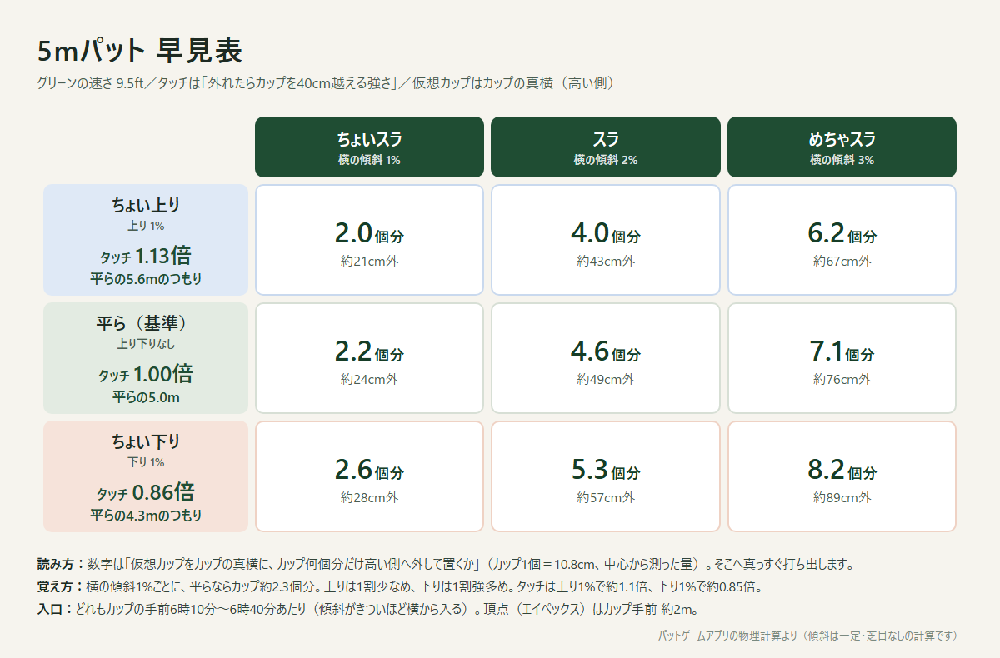

# パットゲームアプリ

グリーンの傾斜とボールのスピードを物理計算して、パットのライン読みを練習する3Dアプリです。
スマホ（横向き）でもパソコンでも、ブラウザで開くだけで使えます。

**開く：** https://sdanno75-spec.github.io/leftputt/

## 考え方（3ステップ）

1. **入口を決める**：傾斜とタッチで、カップの手前半分（3時〜6時〜9時）のどこから入るかが決まります。
2. **仮想カップをカップの真横に置く**：「平らならここへ真っすぐ打つ」という点を、本物のカップの真横（同じ距離）に、高い側へずらして置きます。
3. **エイペックスを確認**：ボールは減速しながら傾斜に負けて曲がり、いちばん膨らんだ点（頂点）を過ぎてから入口へ向かいます。

## できること

- **シミュレーター**：横の傾斜・上り下り・グリーンの速さ・距離・タッチを変えて、正しい読みと曲がり方を見られます。タッチ比較（3球同時）やスロー再生もあります。
- **ゲーム**：ランダムに出る傾斜と距離に対して、仮想カップとタッチを自分で決めて打ちます。答え合わせつき。
- **ラウンド**：外したら止まった場所から返しを打ち、カップインするまで続けます（9／18ホール、1ホール パー2）。
- 左打ち・右打ちの切り替え、アドレス目線の視点、打ったボールを追うカメラ。
- タッチは「平らなら何mのつもりで打つか」で合わせます。

## 5mの早見表（9.5ft・外れたら40cm越えるタッチ）

- 横の傾斜1%ごとに、平らならカップ約2.3個分。上りは1割少なめ、下りは1割強多め。
- タッチは上り1%で約1.1倍、下り1%で約0.85倍。

## ホーム画面に追加して使う

- iPhone：Safariで開き、共有ボタン →「ホーム画面に追加」。アプリのように全画面で開きます。
- 新しい版が出ると、開いたとき（ホーム画面から開き直したときも）に自動で最新になります。ゲームやラウンドの途中は、画面下に「新しい版があります」と出るので、好きなときに「更新する」を押してください。

## メモ

- 3D表示に three.js（ネットから読み込み）を使っています。ネットにつながっている状態で開いてください。
- 計算は「傾斜が一定・芝目なし」のモデルです。実際のグリーンでの目安として使ってください。
